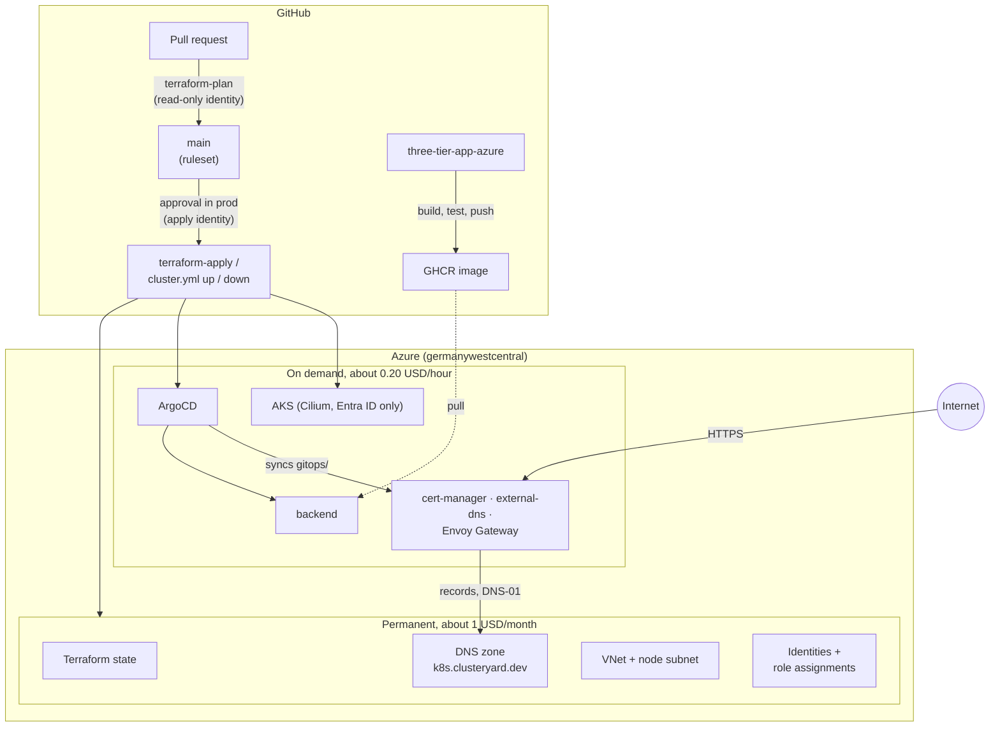

# clusteryard

A production-style Kubernetes platform on Azure, built end to end as code:
Terraform for the infrastructure, GitHub Actions for delivery, ArgoCD for
everything inside the cluster. Every architecture decision is recorded as an
ADR.

The constraint that shapes the design: **a 20 USD monthly budget**. The
foundation is permanent and cheap; the cluster is built when needed and torn
down afterwards, without touching identities, permissions or DNS.

**Status:** runs end to end. One `cluster.yml up` run builds the cluster,
installs ArgoCD, and serves the first workload over trusted HTTPS at
`https://backend.k8s.clusteryard.dev/api`. That URL only answers while a
cluster is up.

---

## What this demonstrates

| Area | How |
|---|---|
| **Zero stored secrets** | GitHub Actions logs in to Azure with OIDC federation. Workloads log in with AKS Workload Identity. Images go to GHCR with the run's own token. No client secret, kubeconfig or registry password anywhere. |
| **Least privilege** | A read-only **plan** identity for pull requests and a write **apply** identity reachable only through a protected environment. The pipeline cannot grant roles or change its own guard rails. |
| **Governance as code** | Branch ruleset, `prod` environment, Actions allowlist with SHA pinning, repository settings: all in Terraform (`infra/github`). |
| **GitOps** | Terraform only bootstraps ArgoCD. ArgoCD runs cert-manager, external-dns, Envoy Gateway and the workloads from `gitops/` (app-of-apps). |
| **Disposable environments** | The cluster lives for hours. Everything it depends on is long-lived, so a rebuild needs no new permissions. |
| **Documented trade-offs** | 10 ADRs with context, alternatives and accepted risks (in German, summaries below). |

## Architecture



### Layers

| Order | Module | Applied by | Lifetime | Contents |
|---|---|---|---|---|
| 1 | `infra/bootstrap` | locally | permanent | budget alert, Terraform state storage |
| 2 | `infra/identity` | locally | permanent | plan and apply identities (OIDC), resource groups |
| 3 | `infra/dns`, `infra/network` | pipeline, on merge | permanent | DNS zone, VNet, node subnet |
| 4 | `infra/cluster-identity` | locally | permanent | `rg-aks`, cluster and workload identities, all role assignments |
| 5 | `infra/cluster` | `cluster.yml` | hours | AKS cluster, federated credentials |
| 6 | `infra/platform` | `cluster.yml` | hours | ArgoCD and the root Application |
| – | `infra/github` | locally | permanent | branch protection, environment, Actions policy |
| – | `gitops/` | ArgoCD | with the cluster | platform components and workloads |

The rule behind the split: **anything that grants permissions, or protects the
pipeline itself, is applied locally.** Everything else goes through the
pipeline.

## Security model

- **Two pipeline identities.** `plan` has `Reader` and can read the state
  without a lock; it is trusted only for `pull_request` tokens. `apply` can
  write to the clusteryard resource groups only, and is trusted only for the
  GitHub environment `prod` (maintainer approval, `main` only). OIDC subjects
  use repository IDs, so a re-created repository with the same name cannot
  take them over.
- **No role assignments from the pipeline.** All roles live in local-only
  modules. A compromised workflow cannot widen its own permissions.
- **Protected `main`.** Pull request required, squash only, a green
  `terraform-plan` from GitHub Actions specifically, branch up to date, no
  bypass, not even for the admin.
- **Supply chain.** Only allowlisted actions, all pinned to commit SHAs.
  Images are pinned by tag and digest.
- **Cluster.** Local accounts disabled; access only through Entra ID and Azure
  RBAC. Workloads run as non-root with a read-only root filesystem under Pod
  Security `restricted`. Cilium enforces NetworkPolicies, with default deny for
  workloads. Only `/api` is routed publicly; health and metrics stay internal.
- **Accepted risks** (written down, not hidden): public API server endpoint,
  no required review while there is a single maintainer, Azure IDs (not
  credentials) in the public repository.

## Delivery flow

1. **Pull request:** `terraform-plan` formats, validates and plans every
   module with the read-only identity. It is the required status check.
2. **Merge:** `terraform-apply` waits for approval in `prod`, then applies the
   long-lived modules from a saved plan.
3. **Cluster:** `cluster.yml` is started by hand (`up` or `down`), also behind
   `prod`. `up` builds the cluster and installs ArgoCD; `down` tears it down in
   reverse order.
4. **Inside the cluster:** ArgoCD polls `main` and syncs `gitops/`.
5. **New app version:** the app repository publishes an image to GHCR; a pull
   request here updates the pinned tag and digest.

Every module under `infra/` must be listed as local-only, auto-apply or
on-demand in the workflow. An unlisted module fails the build, so every new
module forces a decision.

## Cost

| Item | USD/hour |
|---|---|
| System node `Standard_B2ls_v2` | 0.048 |
| Apps node `Standard_B2s_v2` | 0.096 |
| 2 × OS disk, load balancer, 2 public IPs | about 0.05 |
| **Cluster total** | **about 0.20** |

The foundation costs about 1 USD a month. That leaves roughly 100 cluster hours
a month within the budget. A budget alert fires at 80 % and 100 %.

## Repository layout

```
.github/workflows/
  terraform.yml        plan on PRs, apply on merge
  cluster.yml          cluster up / down
infra/                 Terraform modules, one state each (see Layers)
gitops/
  apps/                ArgoCD Applications (synced by the root Application)
  platform/<name>/     manifests for platform components
  workloads/<name>/    manifests for applications
docs/adr/              architecture decision records
```

## Architecture decisions

The ADRs are written in German. One-line summaries:

| ADR | Decision |
|---|---|
| [0001](docs/adr/0001-pipeline-identities.md) | OIDC instead of secrets; separate plan and apply identities; trust bound to repository IDs |
| [0002](docs/adr/0002-network.md) | Address plan: VNet `10.0.0.0/16`, node subnet `/24`, pod and service ranges outside the VNet |
| [0003](docs/adr/0003-dns-zone.md) | `k8s.clusteryard.dev` as an Azure DNS zone, delegated from Cloudflare |
| [0004](docs/adr/0004-aks-basics.md) | On-demand AKS: Cilium, Entra ID only, Workload Identity, two node pools, cost model |
| [0005](docs/adr/0005-argocd-bootstrap.md) | Terraform installs ArgoCD in its own module and state; ArgoCD manages the rest |
| [0006](docs/adr/0006-role-assignments.md) | All role assignments local, on long-lived identities; the pipeline grants nothing |
| [0007](docs/adr/0007-branch-protection.md) | Ruleset, `prod` environment and Actions policy as code |
| [0008](docs/adr/0008-cert-manager-external-dns.md) | cert-manager (DNS-01) and external-dns via GitOps with Workload Identity |
| [0009](docs/adr/0009-envoy-gateway.md) | Gateway API with Envoy Gateway, since ingress-nginx is retired; one wildcard certificate |
| [0010](docs/adr/0010-workloads.md) | Rules for workloads: GHCR, pinned images, hardened pods, default deny, only public paths routed |

## Running it

Prerequisites: an Azure subscription, the Azure CLI, Terraform ≥ 1.5, the
GitHub CLI.

**First-time setup** (once, locally, with `az login`):

```bash
cd infra/bootstrap        && terraform apply   # state storage, budget
cd ../identity            && terraform apply   # pipeline identities
# store the outputs as GitHub Actions variables:
#   AZURE_CLIENT_ID_PLAN, AZURE_CLIENT_ID_APPLY, AZURE_TENANT_ID, AZURE_SUBSCRIPTION_ID
# merge a PR so the pipeline applies infra/dns and infra/network, then:
cd ../cluster-identity    && terraform apply   # cluster identities and roles
cd ../github              && GITHUB_TOKEN=$(gh auth token) terraform apply
```

Each local module has a `terraform.tfvars.example`; the real `.tfvars` files are
gitignored.

**Day to day:**

```bash
gh workflow run cluster.yml -f action=up     # approve in prod, about 10 minutes
gh workflow run cluster.yml -f action=down   # tear down when done
```

**Access to a running cluster:**

```bash
az aks get-credentials -g rg-aks -n aks-clusteryard
kubelogin convert-kubeconfig -l azurecli
kubectl -n argocd port-forward svc/argocd-server 8080:443
```

## Lessons learned

Things that only showed up by running it:

- **VM size vs. quota.** AKS rejected the classic B-series that had quota,
  and the sizes it allowed had none. Fixed by requesting quota for B-series v2
  and switching the pools.
- **Short-lived OIDC tokens.** The token behind `azure/login` expires before
  the cluster is ready, about 10 minutes later. The Kubernetes step fetches a
  fresh GitHub OIDC token and logs in with `kubelogin` in workload identity mode.
- **Plans against a running cluster.** Refreshing the cluster needs
  `listClusterUserCredential`, which `Reader` lacks, so every PR failed while
  a cluster was up. The plan identity got the narrow Cluster User role.
- **Controllers that edit your objects.** cert-manager's cainjector and the AKS
  admissions enforcer both modify webhook configurations. ArgoCD ignores
  exactly those fields instead of fighting them.
- **Importing existing settings.** The first plan for the GitHub settings would
  have wiped the repository description. Reading the plan caught it.

## Roadmap

- Observability: Prometheus and Grafana via ArgoCD (the backend already exposes
  metrics internally)
- tflint and Checkov as additional required checks
- Nightly automatic teardown as a cost safety net
